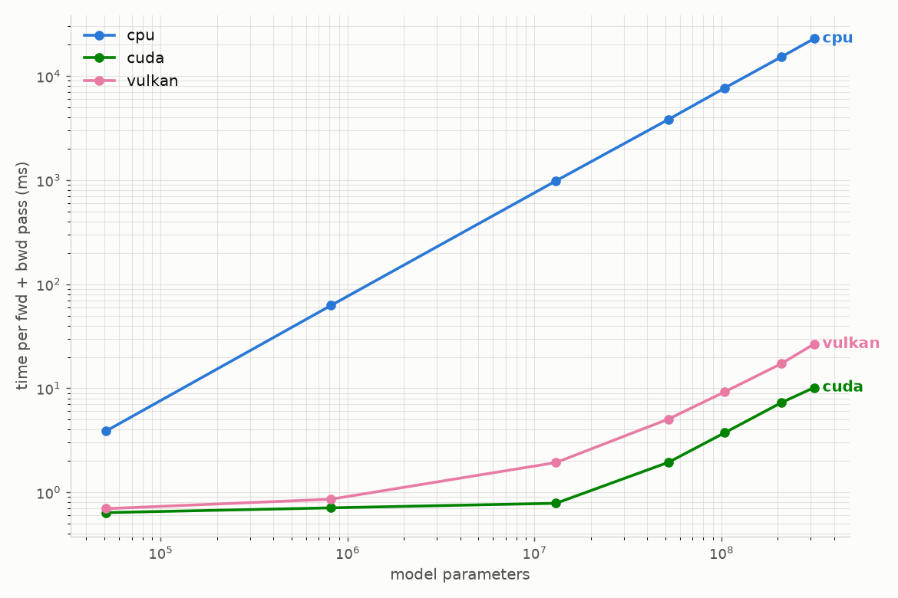

<h1 align="center">torchvulkan</h1>
<p align="center">
  <i>A Cross-Platform Vulkan Backend for PyTorch</i>
</p>

<p align="center">
  <a href="https://github.com/zainsharief/torchvulkan/actions/workflows/test_torchvulkan.yml"></a>
  <a href="LICENSE"></a>
  
  
</p>

`torchvulkan` registers a `vulkan` device with PyTorch and runs tensor operations as [Vulkan](https://www.vulkan.org/) compute shaders. Vulkan runs on GPUs from AMD, Intel, NVIDIA, and Apple (via MoltenVK), plus software rasterizers, so you get one vendor-neutral GPU backend across Linux, macOS, and Windows.

You use it like any other PyTorch device:

```python
import torch
import torchvulkan  # registers the 'vulkan' device on import

x = torch.randn(1024, 1024).to("vulkan")
y = torch.randn(1024, 1024).to("vulkan")

z = (x @ y).relu()      # runs on the GPU via Vulkan compute shaders
print(z.sum().item())   # move a scalar back to the CPU
```

> [!WARNING]
> **Experimental.** `torchvulkan` is an early-stage project. Most of PyTorch's operators run natively on the GPU; the few that don't fall back to the CPU. Expect breaking changes before `1.0`.

## Table of contents

- [Installation](#installation)
- [Quickstart](#quickstart)
- [Examples](#examples)
- [Benchmarks](#benchmarks)
- [Python API](#python-api)
- [CPU fallback](#cpu-fallback)
- [Environment variables](#environment-variables)
- [Limitations](#limitations)
- [How it works](#how-it-works)

## Installation

```bash
pip install torchvulkan
```

At runtime you need a **Vulkan 1.3 (or newer) driver**: your GPU's driver on Linux and Windows. On macOS the wheel bundles [MoltenVK](https://github.com/KhronosGroup/MoltenVK), so nothing else is needed; set `TORCHVULKAN_SYSTEM_VULKAN=1` to use the system Vulkan loader instead. Verify it worked:

```python
import torchvulkan
print(torchvulkan.is_available(), torchvulkan.device_count())
```

## Quickstart

```python
import torch
import torchvulkan

# Move tensors to the Vulkan device
a = torch.tensor([[1.0, 2.0], [3.0, 4.0]], device="vulkan")
b = torch.ones(2, 2, device="vulkan")

c = a @ b + 1.0          # matmul + broadcasted add
d = c.exp().sum(dim=0)   # elementwise + reduction

print(d.cpu())           # bring the result back to the CPU
```

`nn.Module`s move to the device the usual way:

```python
model = torch.nn.Linear(128, 10).to("vulkan")
out = model(torch.randn(32, 128).to("vulkan"))
```

## Examples

Each example trains a model end to end on the Vulkan device: forward pass, loss, backward pass and optimizer step all run through the backend.

| Example | Model | Data |
| --- | --- | --- |
| [`examples/mlp.py`](examples/mlp.py) | A multi-layer perceptron with GELU and dropout, trained with AdamW | MNIST |
| [`examples/llm.py`](examples/llm.py) | A small modern decoder-only transformer: RMSNorm, rotary embeddings, grouped-query attention, a SwiGLU MLP and tied embeddings. Samples text when it's done | Its own source code, character by character |
| [`examples/resnet.py`](examples/resnet.py) | A ResNet with residual blocks, batch norm and global average pooling, trained with SGD and a one-cycle schedule | CIFAR-10 |

```bash
pip install torchvision     # for the MNIST and CIFAR-10 datasets
python examples/mlp.py
python examples/llm.py
python examples/resnet.py
```

Training looks the same as on any other device:

```python
device = torch.device("vulkan" if torchvulkan.is_available() else "cpu")
model = ResNet().to(device)
optimizer = torch.optim.SGD(model.parameters(), lr=0.1, momentum=0.9)

for data, targets in train_loader:
    data, targets = data.to(device), targets.to(device)
    loss = criterion(model(data), targets)
    optimizer.zero_grad()
    loss.backward()
    optimizer.step()
```

## Benchmarks

[`benchmark/benchmark.py`](benchmark/benchmark.py) times a combined forward + backward pass (`float16` on accelerators, `float32` on CPU) on every available backend, sweeping each model's size. Each backend runs in its own subprocess. The models are the ones from the [examples](#examples):

- `mlp`: sweeps the hidden width, up to ~141M parameters.
- `llm`: sweeps the model width (`n_embd`), up to ~26M parameters.
- `resnet`: sweeps the base channel width, up to ~6M parameters.

<p align="center">
  
</p>

<p align="center">
  <i>Vulkan vs. CUDA vs. CPU.</i>
</p>

```bash
pip install matplotlib
python benchmark/benchmark.py all    # every model
```

## Python API

`torchvulkan` mirrors the `torch.cuda` module, and is also reachable as `torch.vulkan`:

```python
import torchvulkan

# devices
torchvulkan.is_available()            # -> bool: a usable Vulkan device was found
torchvulkan.device_count()            # -> int: number of Vulkan devices (discrete GPUs first)
torchvulkan.current_device()          # -> int: index of the current device
torchvulkan.set_device(1)             # make "vulkan" mean "vulkan:1"
torchvulkan.get_device_name()         # -> str
torchvulkan.get_device_properties()   # -> name, total_memory, vendor_id, api_version, subgroup_size, ...
torchvulkan.synchronize()             # block until queued GPU work has finished

# memory
torchvulkan.memory_allocated()        # bytes held by tensors
torchvulkan.max_memory_allocated()    # peak since the last reset_peak_memory_stats()
torchvulkan.memory_reserved()         # bytes held by the allocator, including its cache
torchvulkan.memory_stats()            # -> dict
torchvulkan.mem_get_info()            # -> (free, total): what can be allocated given the budget
torchvulkan.empty_cache()             # release cached device memory back to the driver

# random numbers (per-device)
torchvulkan.manual_seed(0)            # also: manual_seed_all, seed, seed_all, initial_seed
torchvulkan.get_rng_state()           # also: set_rng_state, get_rng_state_all, set_rng_state_all

torchvulkan.is_bf16_supported()       # -> bool: bfloat16 runs on the GPU
torchvulkan.__version__               # package version
```

Importing `torchvulkan` registers the backend, after which the device is addressed as `"vulkan"` / `torch.device("vulkan")` throughout PyTorch.

## CPU fallback

By default, any operation, dtype, or tensor shape the backend doesn't implement natively runs on the **CPU**, so models keep working despite partial coverage. Every such fallback prints a `torchvulkan [WARNING]` naming the operation and the reason (an unimplemented operator, an unsupported dtype such as `bfloat16` on devices without `VK_KHR_shader_bfloat16`, or a shape the kernels can't handle). Each warning is printed once per kind of fallback; call `torch.set_warn_always(True)` to see every occurrence.

Set `TORCHVULKAN_STRICT=1` to turn all of these fallbacks into errors. This is useful for finding which operators a workload actually needs:

```bash
TORCHVULKAN_STRICT=1 python your_script.py
```

## Environment variables

| Variable | Effect |
| --- | --- |
| `TORCHVULKAN_STRICT=1` | Raise an error instead of falling back to the CPU (unimplemented operators, unsupported dtypes or shapes). |
| `TORCHVULKAN_SYSTEM_VULKAN=1` | macOS: use the system Vulkan loader instead of the bundled MoltenVK. |
| `TORCHVULKAN_VALIDATION=1` | Enable the Khronos validation layer, if it's installed. `=sync` also enables synchronization validation. On macOS this needs `TORCHVULKAN_SYSTEM_VULKAN=1`. |
| `TORCHVULKAN_PROFILE=1` | Print each compute pipeline's driver statistics (such as register use) when it's compiled, on drivers that support `VK_KHR_pipeline_executable_properties`. |
| `TORCHVULKAN_PIPELINE_CACHE=0` | Don't cache compiled pipelines between runs. By default they're cached in `%LOCALAPPDATA%\torchvulkan` on Windows and `$XDG_CACHE_HOME/torchvulkan` (or `~/.cache/torchvulkan`) elsewhere. |
| `TORCHVULKAN_CACHE_DIR` | Directory for the pipeline cache. |

## Limitations

- `torch.compile` with the default Inductor backend doesn't support the `vulkan` device. Run eagerly, or use `torch.compile(model, backend="aot_eager")`.
- Optimizers created with `fused=True` (such as `torch.optim.AdamW(..., fused=True)`) run their update on the CPU. The default (foreach) implementation runs on the GPU.
- `float64` runs on the GPU only on devices with `shaderFloat64`; elsewhere it falls back to the CPU. Transcendental functions such as `exp`, `sin` and `tanh` are computed in `float32` precision for `float64` tensors.
- `bfloat16` runs on the GPU only on devices with `VK_KHR_shader_bfloat16`; elsewhere it falls back to the CPU.
- Complex tensors can live on the device and FFTs run on the GPU, but most complex arithmetic falls back to the CPU.
- `torch>=2.10.0` only. The extension is compiled against 2.13.0 but has testing support for >=2.10.0.
- APIs and coverage may change before `1.0.0`.

## How it works

1. Importing the package registers a PyTorch `PrivateUse1` backend and renames it to `vulkan`.
2. Operations dispatched to a `vulkan` tensor are routed to native implementations that record and submit **Vulkan compute shaders**. The shaders are written in [Slang](https://github.com/shader-slang/slang), compiled to SPIR-V at build time, and embedded into the extension.
3. Device memory is managed with [VMA](https://github.com/GPUOpen-LibrariesAndSDKs/VulkanMemoryAllocator); Vulkan entry points are loaded with [volk](https://github.com/zeux/volk).
4. Anything without a native implementation is handled by [CPU fallback](#cpu-fallback).


> [!NOTE]
> **Disclaimer:** `torchvulkan` is an independent open-source project and is not affiliated with or endorsed by PyTorch or the Linux Foundation.
